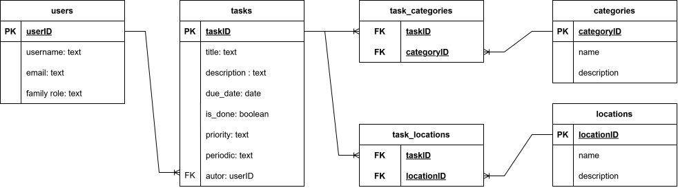

### 1. Исходная (денормализованная) структура
Представьте, что вы сложили всё в одну таблицу (или несколько сильно дублирующихся):
`Tasks (taskID, title, description, due_date, is_done, priority, periodic, authorID, username, email, family_role, categoryID, category_name, locationID, location_name)`

**Проблемы этой структуры:**
*   **Избыточность:** Данные пользователя (`username`, `email`, `family_role`) повторяются для каждой его задачи. Данные локации (`location_name`) дублируются для каждой задачи в этом месте.
*   **Аномалия обновления:** При изменении email пользователя или названия локации придется обновлять все связанные строки в таблице задач.
*   **Аномалия удаления:** При удалении последней задачи пользователя или последней задачи для определенной локации мы можем безвозвратно потерять информацию о самом пользователе или локации.

### 2. Нормализация до 1NF (Первая нормальная форма)
*   **Требование:** Все атрибуты должны быть атомарными. Нельзя хранить список категорий или локаций в одной ячейке (например, строку "1,2,3").
*   **Решение:** Выносим справочники в отдельные таблицы. Создаем таблицы `categories` (для категорий) и `locations` (для мест выполнения). В таблице задач оставляем только ссылки на них (ID).

### 3. Нормализация до 2NF (Вторая нормальная форма)
*   **Требование:** Каждый неключевой атрибут должен зависеть от всего первичного ключа (устраняем частичные зависимости).
*   **Решение:** Выносим данные пользователей в отдельную таблицу `users`. В таблице `tasks` оставляем только `author` (внешний ключ на `userID`). Остальные атрибуты задачи (`title`, `due_date`, `is_done`, `priority`, `periodic`) зависят непосредственно от `taskID`.

### 4. Нормализация до 3NF (Третья нормальная форма)
*   **Требование:** Нет транзитивных зависимостей (неключевые атрибуты не должны зависеть друг от друга).
*   **Пример транзитивной зависимости:** Если бы в таблице `Tasks` остались поля `category_name` или `location_name`, они зависели бы от `categoryID` и `locationID` соответственно, а не от `taskID`.
*   **Решение:** Убираем названия и описания категорий и локаций из таблицы `Tasks`. Оставляем их только в таблицах `Categories` и `Locations`.

### 5. Реализация связи «многие-ко-многим» (M:N)
В реляционной БД связь M:N (например, одна задача может иметь несколько категорий и выполняться в нескольких локациях, а одна категория/локация может относиться ко многим задачам) реализуется через промежуточные таблицы.
*   Создаем таблицу `task_categories (taskID, categoryID)`.
*   Создаем таблицу `task_locations (taskID, locationID)`.
Они хранят пары ID и реализуют связи.

### 6. Финальная схема

